<p align="center">
  
</p>

<p align="center">
  <a href="https://github.com/skaskz/tabspace/releases/latest"></a>
  <a href="https://github.com/skaskz/tabspace/actions/workflows/ci.yml"></a>
  <a href="https://github.com/skaskz/tabspace/actions/workflows/e2e.yml"></a>
  
  <a href="LICENSE"></a>
</p>

<p align="center">
  <b>Workspaces, tab groups, tasks, notes, bookmarks, calendar and focus — in one calm, monochrome space.</b><br/>
  A local-first Chrome extension. No account, no server, no tracking.
</p>

<p align="center">
  <a href="#features">Features</a> ·
  <a href="#screenshots">Screenshots</a> ·
  <a href="#install">Install</a> ·
  <a href="#updating">Updating</a> ·
  <a href="docs/USER_GUIDE.md">User guide</a> ·
  <a href="#development">Development</a> ·
  <a href="#architecture">Architecture</a> ·
  <a href="docs/PRIVACY.md">Privacy</a>
</p>

<br/>

<p align="center">
  <a href="https://cdn.jsdelivr.net/gh/skaskz/tabspace@main/docs/media/tabspace-promo.mp4">
    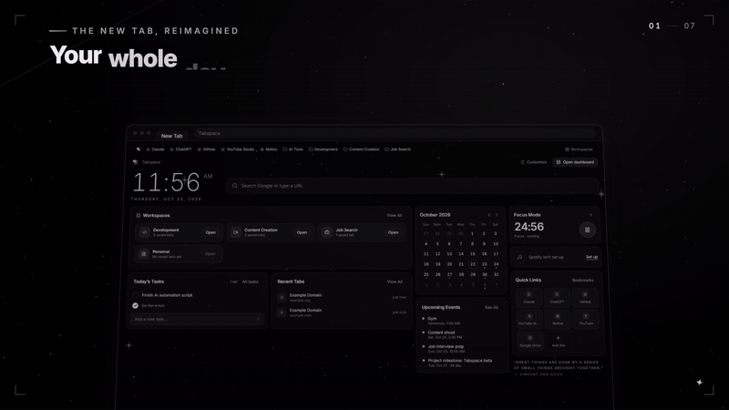
  </a>
  <br/>
  <sub>▶ <a href="https://cdn.jsdelivr.net/gh/skaskz/tabspace@main/docs/media/tabspace-promo.mp4">Watch the full 50-second tour</a> (MP4, with sound)</sub>
</p>

## Features

| | |
| --- | --- |
| **Workspaces** | Separate spaces (*Development*, *Content Creation*, *Job Search*…) that remember their tabs, tasks, notes and bookmarks. Re-open one and it comes back as a native Chrome tab group. |
| **Tab manager** | Search, group, rename, recolour, pin, move and close tabs across windows. Save and restore sessions. Optional rule-based smart grouping that runs on your device. |
| **New Tab hub** | Clock, search, workspaces, today's tasks, calendar, focus timer, Spotify and quick links. Every section can be shown, hidden or moved. |
| **Tasks · Notes · Bookmarks** | Fast, simple and linked to your workspaces. Quick Note capture from any site with <kbd>Alt</kbd>+<kbd>Shift</kbd>+<kbd>N</kbd>. |
| **Calendar** | Month, week, day and agenda views. Local events, ICS feeds, `.ics` import and read-only Google Calendar. |
| **Focus Mode** | A Pomodoro timer that stays correct across every page, the sidebar and the toolbar badge, with a chime, optional site blocking and Spotify controls. |
| **Tabspace Bar** | An optional bookmarks bar with folders, a Workspaces menu and a one-click *Bookmark this page* folder picker. |
| **Analytics** | Built only from what you actually recorded. No invented numbers. |
| **Polish** | Deep-space theme with a 3D parallax starfield, smooth motion that respects reduced-motion, a matching Chrome theme, and keyboard access throughout. |

Everything is stored in `chrome.storage.local` on your device. The only network request Tabspace makes on its own is an
optional, anonymous update check against this repository's releases ([details](docs/PRIVACY.md)).

## Screenshots

<p align="center">
  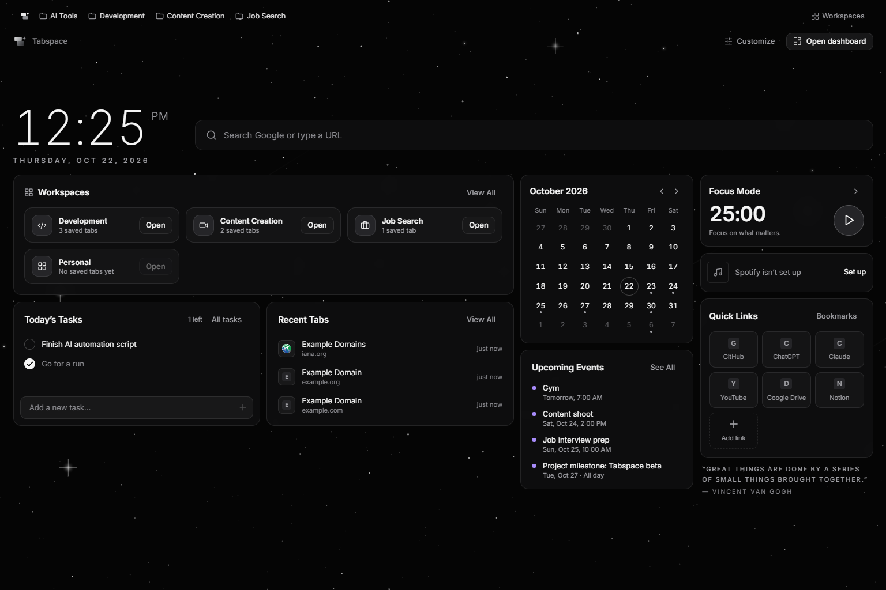
  <br/><sub>New Tab hub</sub>
</p>

<table>
  <tr>
    <td width="50%">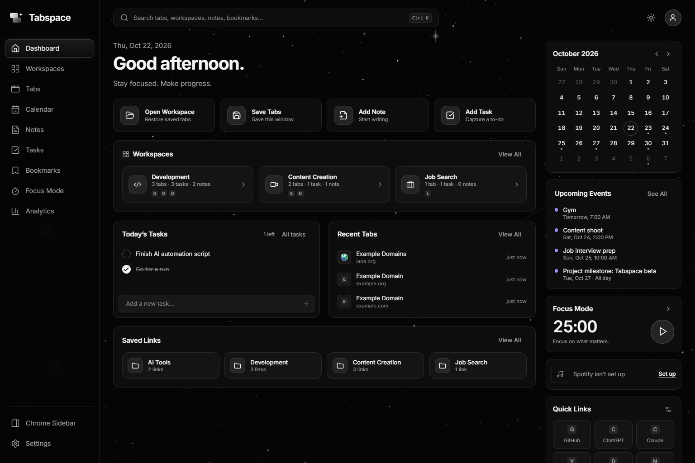<p align="center"><sub>Dashboard</sub></p></td>
    <td width="50%">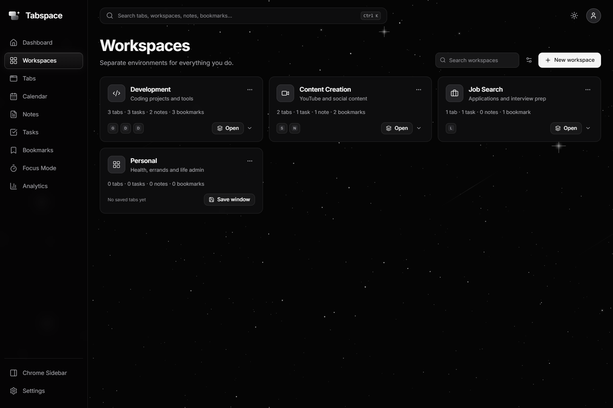<p align="center"><sub>Workspaces</sub></p></td>
  </tr>
  <tr>
    <td>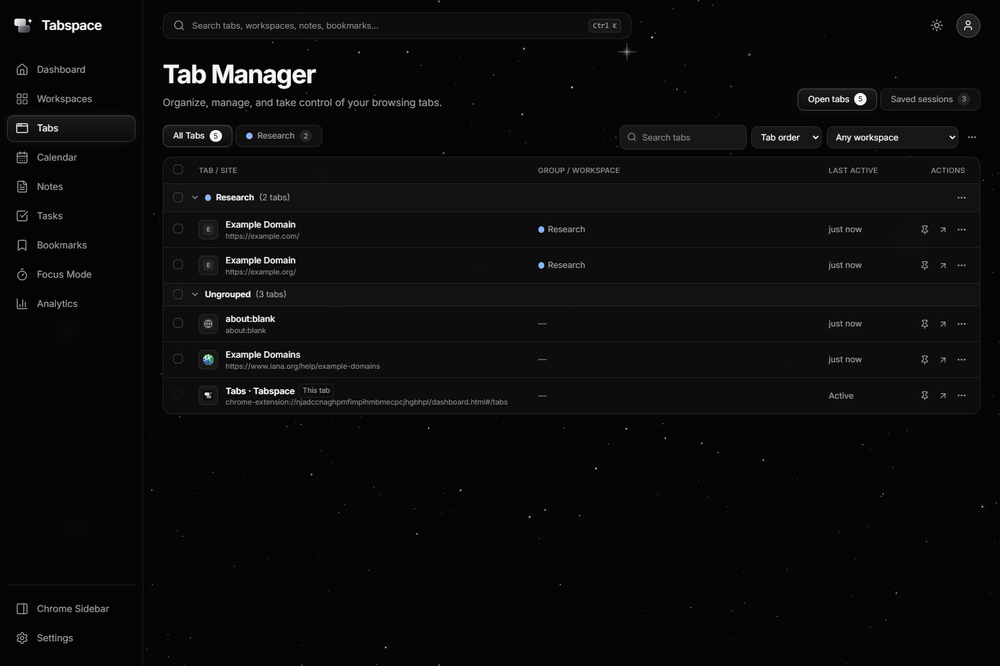<p align="center"><sub>Tab manager</sub></p></td>
    <td>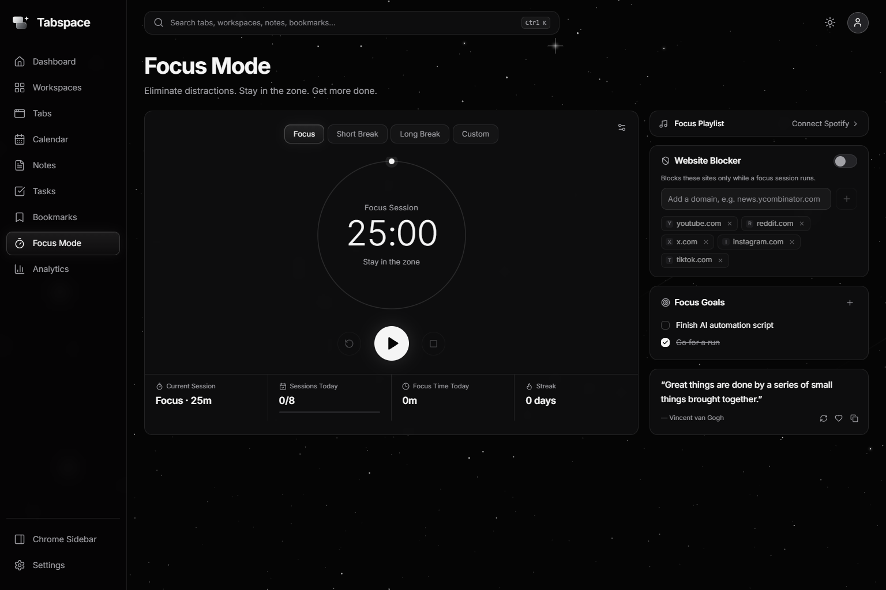<p align="center"><sub>Focus Mode</sub></p></td>
  </tr>
</table>

<details>
<summary><b>More screenshots</b> — calendar, notes, tasks, bookmarks, analytics, settings, side panel, popup</summary>
<br/>
<table>
  <tr>
    <td width="50%">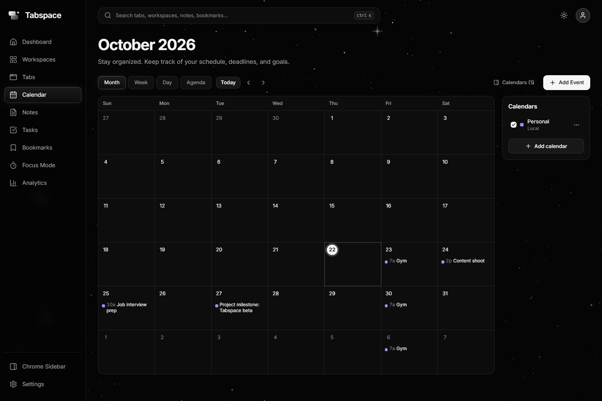<p align="center"><sub>Calendar</sub></p></td>
    <td width="50%">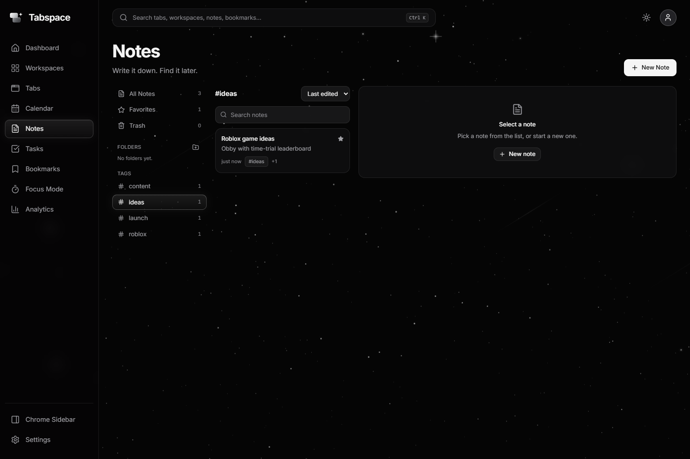<p align="center"><sub>Notes</sub></p></td>
  </tr>
  <tr>
    <td>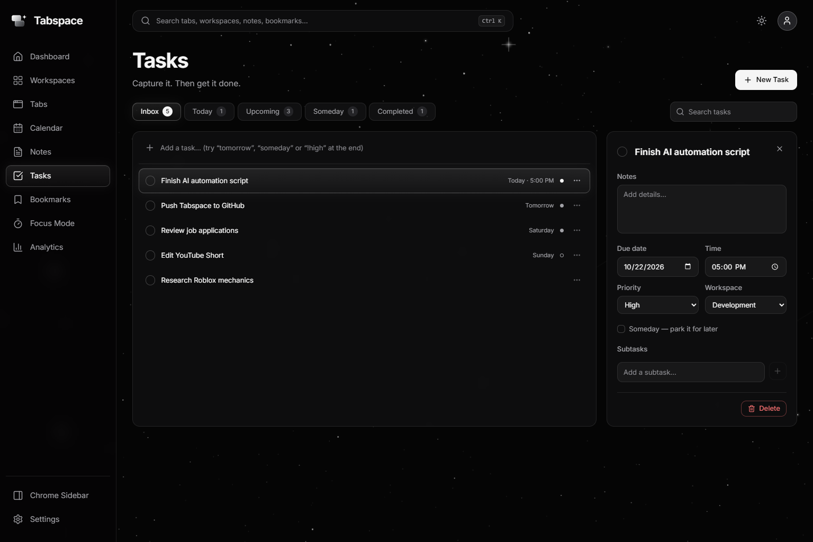<p align="center"><sub>Tasks</sub></p></td>
    <td>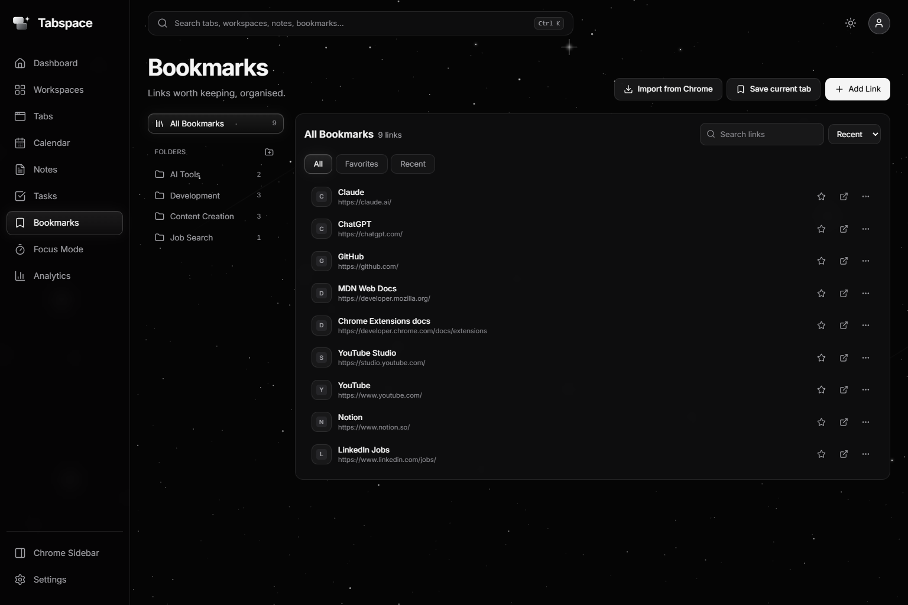<p align="center"><sub>Bookmarks</sub></p></td>
  </tr>
  <tr>
    <td>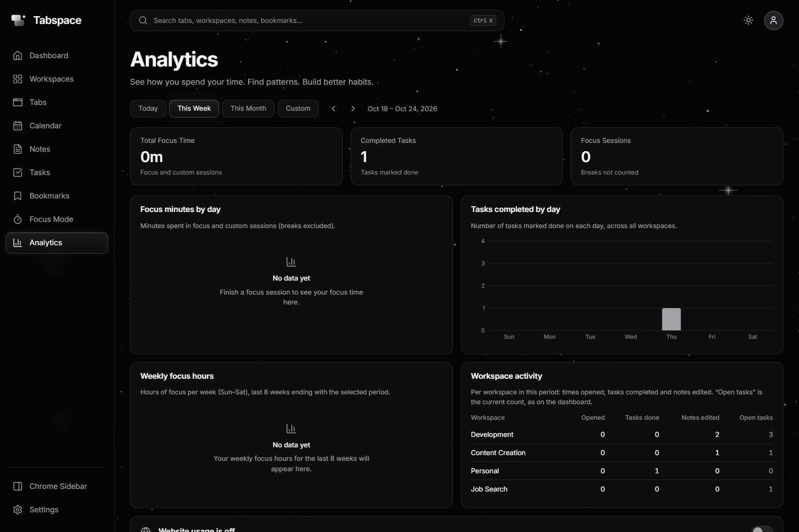<p align="center"><sub>Analytics</sub></p></td>
    <td>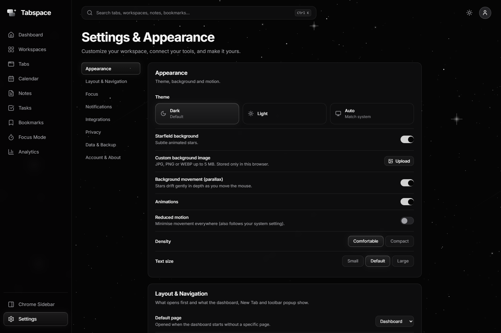<p align="center"><sub>Settings</sub></p></td>
  </tr>
  <tr>
    <td>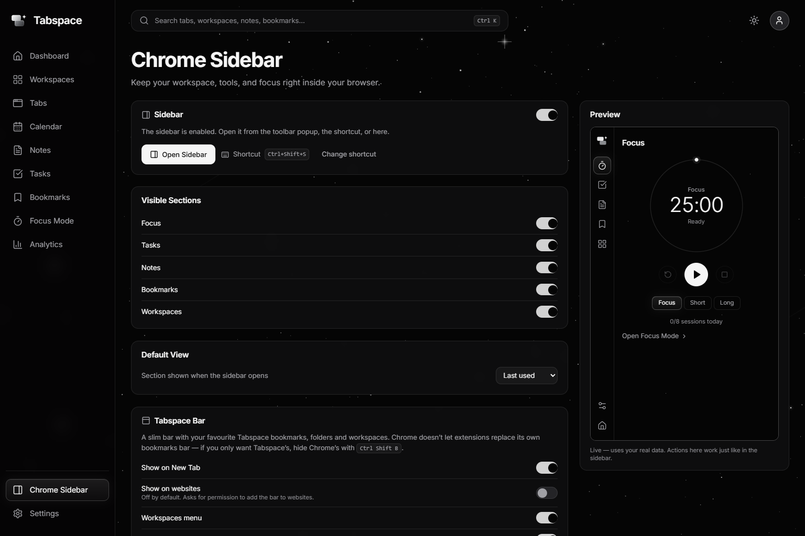<p align="center"><sub>Chrome Sidebar settings</sub></p></td>
    <td align="center">
      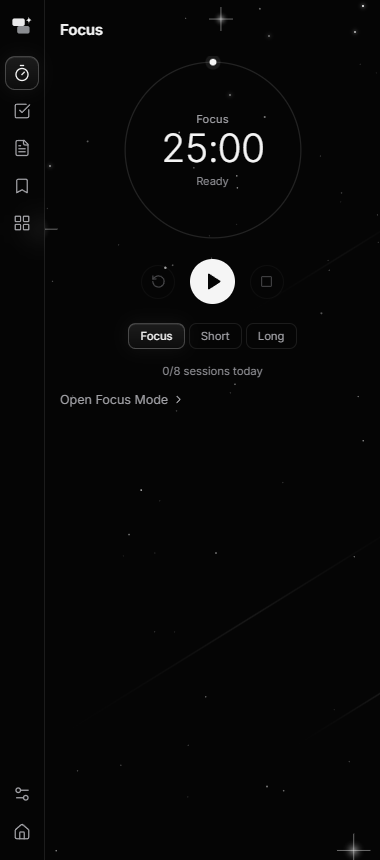
      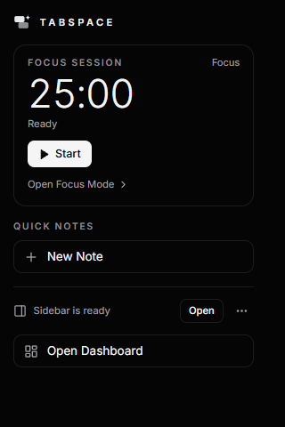
      <p align="center"><sub>Side panel &amp; toolbar popup</sub></p>
    </td>
  </tr>
</table>
</details>

## Install

Requires Google Chrome 116 or newer (or another Chromium browser).

1. Download **`tabspace-extension-<version>.zip`** from the [latest release](https://github.com/skaskz/tabspace/releases/latest) and unzip it somewhere permanent (e.g. `Documents/Tabspace`).
2. Open `chrome://extensions` and turn on **Developer mode** (top right).
3. Click **Load unpacked** and choose the unzipped folder.
4. Pin Tabspace from the puzzle-piece menu, then open a new tab.

Want the matching dark Chrome theme? Load `tabspace-theme-<version>.zip` the same way. See the
[user guide](docs/USER_GUIDE.md) for shortcuts, the Tabspace Bar, tab groups and integrations.

## Updating

Chrome only auto-updates extensions installed from the Web Store, so Tabspace checks this repository itself.

When a new version is released, Tabspace shows **Download update** on the dashboard, in Settings and in the toolbar popup:

1. Click **Download update**.
2. Unzip it over your Tabspace folder, replacing the files.
3. Click **Reload Tabspace**. Your workspaces, tasks and notes stay as they are.

The check runs twice a day, sends nothing about you, and can be turned off in *Settings → Account & About*.

## Development

```bash
git clone https://github.com/skaskz/tabspace.git
cd tabspace
npm install
npm run build        # type-check + production build into dist/  → load dist/ unpacked
```

| Command | What it does |
| --- | --- |
| `npm run dev` | Vite dev server at `localhost:5179/dashboard.html` (no Chrome APIs; data in localStorage) |
| `npm test` | Unit, integration and security tests (Vitest) |
| `npm run test:e2e` | Loads the real unpacked extension into Chromium (Playwright; run `npx vite build` first) |
| `npm run lint` · `npm run typecheck` | ESLint · TypeScript |
| `npm run icons` · `npm run theme` | Re-render icons from the SVG logo · rebuild the Chrome theme |
| `npm run release 2.4.0` | Bump versions, commit and tag; pushing the tag publishes a GitHub Release |

<details>
<summary><b>How releases work</b></summary>
<br/>

`npm run release X.Y.Z` bumps `package.json` and `manifest.json`, makes sure `CHANGELOG.md` has an entry, then commits and
tags `vX.Y.Z`. Pushing the tag (`git push && git push --tags`) runs [`release.yml`](.github/workflows/release.yml), which
type-checks, lints, tests, builds and attaches `tabspace-extension-vX.Y.Z.zip` and `tabspace-theme-vX.Y.Z.zip` to a new
GitHub Release with the changelog as notes. Installed copies see it within 12 hours.
</details>

## Architecture

```
src/
  app/            hash router, providers, theme controller
  components/     ui/ primitives (Button, Modal, Menu, Toggle…) and layout/ (AppShell, Starfield, Logo)
  pages/          the 12 dashboard pages
  extension/      background/ (service worker), sidebar/, popup/, newtab/, bar/
  features/       pure, unit-tested logic per area
  integrations/   google/, spotify/, calendars/
  services/       Chrome API wrappers (sessions, tabs, focus, backup, updates)
  storage/        chrome.storage adapter, schema, migrations
promo/            Remotion source for the promo video
tests/            unit/ integration/ security/ e2e/
```

- **Local-first storage**: one `chrome.storage.local` key per collection, a per-page cache synced through `storage.onChanged`, and Web Locks to serialize writes across the dashboard, sidebar, popup and New Tab.
- **Stable app IDs** for saved tabs, groups and sessions. Chrome's runtime IDs are never persisted.
- **Focus timer** derives from a persisted end timestamp plus `chrome.alarms`, so MV3 service-worker suspension can't break it.
- **Minimal permissions**: optional permissions are requested only when a feature needs them. No remote code.
- **Small dependency list**: React, lucide-react, recharts, ical.js and the Inter font.

More in [docs/ARCHITECTURE.md](docs/ARCHITECTURE.md).

## Testing

Four layers: unit, integration and security regression tests (Vitest), plus end-to-end tests that load the real unpacked
extension into Chromium (Playwright). Latest run: **1,005 Vitest tests and 207 Playwright E2E tests passing**, with 0 type
errors, 0 lint errors and 0 known vulnerabilities. CI runs all of them on every push.

Independent QA, security, UX and final-review passes found 10 functional bugs (3 data-loss), 7 security issues and 15 UX
issues during development. All are fixed with regression tests. See [docs/TESTING.md](docs/TESTING.md).

## Privacy & security

Local-only data, opt-in website tracking (domains and time only), read-only Google scope, PKCE for Spotify, and tokens that
are never exported. Full details in [docs/PRIVACY.md](docs/PRIVACY.md); limitations in
[docs/KNOWN_LIMITATIONS.md](docs/KNOWN_LIMITATIONS.md).

## How it was built

Tabspace was built with a multi-agent AI workflow. A lead agent set the architecture, data models and module ownership;
parallel agents built the UI, the extension layer, workspaces and tabs, and the integrations; then separate QA, security,
UX and review agents tested the work, and every finding went back to its owner and was re-tested. Their reports are in
[docs/qa](docs/qa) and [docs/reviews](docs/reviews).

## Roadmap

- Chrome Web Store listing (automatic updates without the download step)
- Optional end-to-end-encrypted sync between devices
- Per-occurrence edits for repeating events; opt-in Google Calendar editing
- More on-device smart-grouping signals

## License

[MIT](LICENSE)
